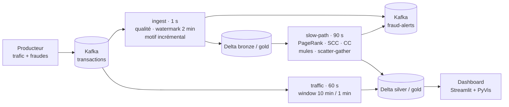
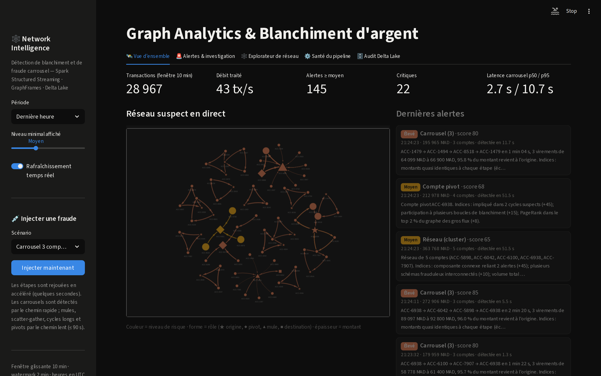
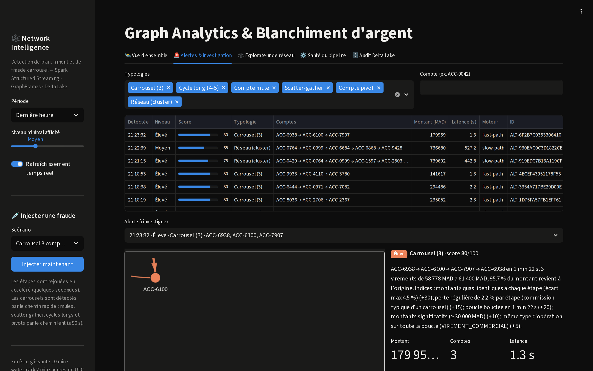
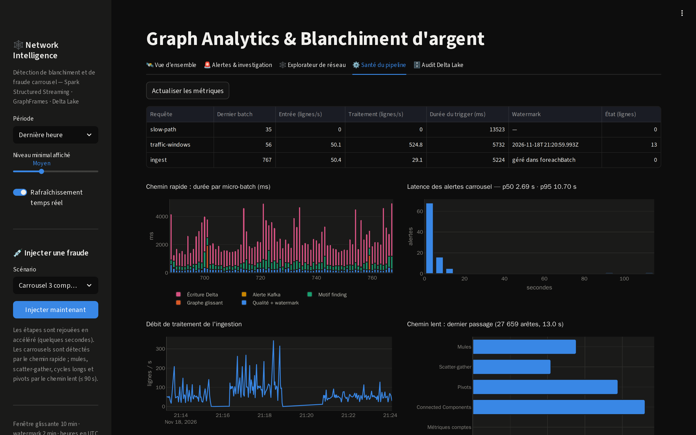
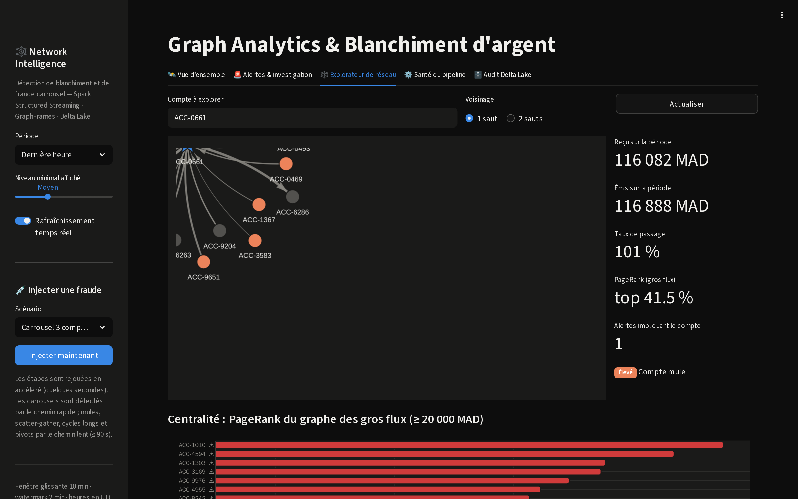
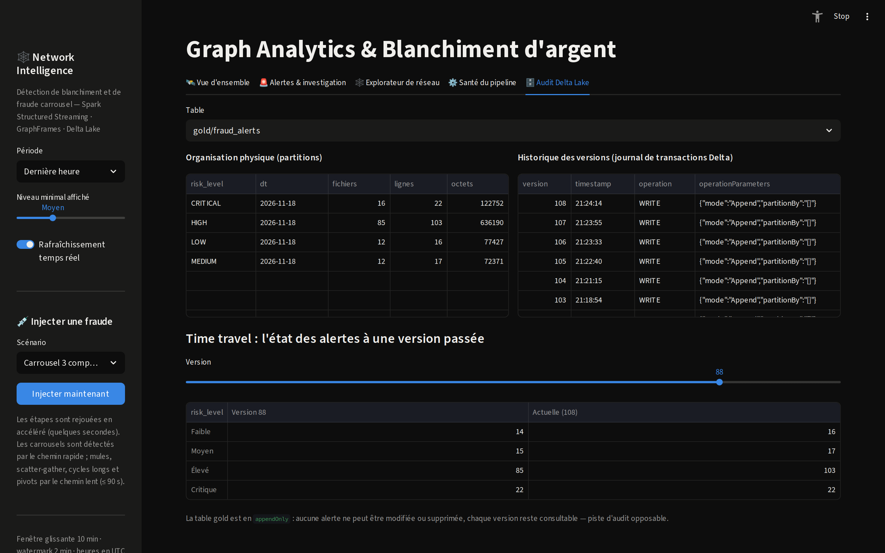

# Graph Analytics & Blanchiment d'argent — Mini-Projet 17

Détection en flux de la **fraude en carrousel** et des **structures de blanchiment en boucle**
avec Kafka, Spark Structured Streaming, GraphFrames et Delta Lake.

 
 


Le système construit en continu un **graphe orienté** des virements (comptes = sommets,
transactions = arêtes) et le fait analyser à **deux vitesses** :

- le **chemin rapide** cherche, à chaque micro-batch, les boucles `(a)→(b)→(c)→(a)` fermées par
  les nouvelles transactions et publie l'alerte dans Kafka en quelques secondes ;
- le **chemin lent** analyse toute la fenêtre de 10 minutes : **PageRank** (comptes pivots),
  **composantes fortement connexes** et **cycles longs**, **comptes mules**, **scatter-gather**,
  **Connected Components** (réseaux reliant plusieurs alertes).

Chaque alerte reçoit un **score expliqué en français**, est historisée avec son sous-graphe
dans un **lakehouse Delta** partitionné `risk_level / dt=YYYY-MM-DD`, et s'explore dans un
**dashboard Streamlit + PyVis** — d'où l'on peut aussi **injecter une fraude en direct**.

## Architecture



Détails et justifications : **[docs/architecture.md](docs/architecture.md)**.

## Le dashboard



| Alertes & investigation | Santé du pipeline |
|---|---|
|  |  |
| **Explorateur de réseau** | **Audit Delta Lake** |
|  |  |

## Livrables

| Livrable (sujet) | Rôle | Points clés |
|---|---|---|
| [`financial_graph_producer.py`](financial_graph_producer.py) | Générateur de transactions et injection de cycles | Population réaliste (loi de puissance, commerçants hubs), 5 typologies de fraude, vérité terrain dans `ground-truth`, événements tardifs et messages invalides |
| [`spark_graph_fraud_streaming.py`](spark_graph_fraud_streaming.py) | Streaming, motifs en boucle, PageRank | 3 requêtes, motif GraphFrames incrémental, SCC + élagage, CC, alertes Kafka, écritures Delta idempotentes |
| [`fraud_graph_delta_schema.py`](fraud_graph_delta_schema.py) | Schéma DDL d'audit et d'historisation | Médaillon bronze/silver/gold, `risk_level/dt`, contraintes `CHECK`, `appendOnly` |
| [`graph_network_dashboard.py`](graph_network_dashboard.py) | Navigation visuelle dans les graphes | Temps réel, sous-graphes PyVis, fiche PDF, PageRank, santé du pipeline, time travel Delta, injection |

Le code partagé est dans [`fraud/`](fraud/) (scénarios, scoring, détection, index du graphe
glissant, lecture du lakehouse, rendu).

## Démarrage rapide

**Prérequis : Docker Desktop avec au moins 6 Go de RAM.** Rien d'autre à installer
(Java 17, Spark, les jars Kafka/Delta/GraphFrames sont dans l'image).

```powershell
.\scripts\demo.ps1 start        # ou : docker compose up -d --build
```

| Service | URL |
|---|---|
| Dashboard | http://localhost:8501 |
| Spark UI (onglet *Structured Streaming*) | http://localhost:4040 |
| Kafka UI (optionnel : `docker compose --profile tools up -d kafka-ui`) | http://localhost:8080 |

Les premières alertes arrivent après ~1 minute (le producteur injecte une fraude toutes les
45 s). La détection des mules a besoin de ~12 minutes d'historique (rythme habituel des comptes). Pour en injecter une tout de suite : bouton **Injecter maintenant** dans la barre
latérale du dashboard, ou `.\scripts\demo.ps1 inject PIVOT_HUB`.

## Commandes utiles

| Commande | Effet |
|---|---|
| `.\scripts\demo.ps1 crash` | Tue Spark, le redémarre, vérifie l'intégrité du lakehouse (0 doublon) |
| `.\scripts\demo.ps1 evaluate` | Rappel, précision, latence → `docs/resultats.md` |
| `.\scripts\demo.ps1 ablation` | Ce qu'apporte chaque filtre de détection |
| `.\scripts\demo.ps1 benchmark` | Montée en charge → `docs/benchmark.md` |
| `.\scripts\demo.ps1 tests` | `ruff` + `pytest` (tests pur Python et Spark) |
| `.\scripts\demo.ps1 logs` | Journal des alertes du job Spark |
| `.\scripts\demo.ps1 reset` | Arrêt et suppression des données |
| `docker compose exec producer python financial_graph_producer.py --inject CARROUSEL --tempo 0.05` | Injection d'une fraude depuis le terminal |
| `python fraud_graph_delta_schema.py --print-ddl` | DDL complet du lakehouse (copie : [docs/ddl.sql](docs/ddl.sql)) |

Variables de configuration (fichier [`fraud/config.py`](fraud/config.py)) : `RATE`,
`FRAUD_EVERY`, `WINDOW_MINUTES`, `WATERMARK_MINUTES`, `SLOW_PATH_SECONDS`, `HIGH_VALUE_MAD`,
`KAFKA_MIN_LEVEL`, etc. Exemple : `$env:RATE=100; docker compose up -d producer`.

## Le message JSON

Conforme au sujet :

```json
{"transaction_id": "TXN-2026-8821", "source_account": "ACC-8812", "target_account": "ACC-4490",
 "montant": 45000.00, "devise": "MAD", "type_operation": "VIREMENT_COMMERCIAL",
 "timestamp": "2026-10-07T10:15:00Z"}
```

## Typologies détectées

| Fraude injectée | Détecteur | Algorithme |
|---|---|---|
| Carrousel 3 comptes | chemin rapide | Motif GraphFrames `(a)-[e1]->(b); (b)-[e2]->(c); (c)-[e3]->(a)`, ordre temporel, ≤ 10 min |
| Cycle long 4-5 comptes | chemin lent | Élagage + SCC, motif à 4/5 sauts dans les SCC |
| Compte mule (smurfing) | chemin lent | Rafale de ≥ 6 dépôts, 3× le rythme habituel du compte, puis un retrait unique de 75-100 % |
| Scatter-gather | chemin lent | Motif à 2 sauts `(s)->(m)->(t)` avec ≥ 3 intermédiaires |
| Pivot de plusieurs carrousels | chemin lent | Participation à ≥ 2 cycles + PageRank du graphe des gros flux |
| Réseau de schémas liés | chemin lent | Connected Components sur le sous-graphe des comptes alertés |

## Résultats

Run de 42 minutes (12 min de chauffe, puis 30 min à 50 transactions/s avec une fraude toutes
les 30 s), mesuré contre la vérité terrain publiée par le producteur :

| Indicateur | Valeur |
|---|---|
| Précision des alertes (niveau ≥ moyen) | **99,0 %** (101 / 102) |
| Rappel | **92,9 %** (39 / 42) — 100 % des carrousels, pivots, cycles longs et scatter-gather ; mules 12 / 15 |
| Détection d'un carrousel | **3,9 s** en médiane (8 s au maximum) |
| Latence du chemin rapide | 3,8 s (p50) · 10,7 s (p95) |
| Ablation (carrousels) | précision 29 % → 75 % → 99 % (motif seul → + ordre temporel → + score), aucun vrai carrousel perdu |
| Panne de Spark (`kill -9`) | 0 transaction et 0 alerte en double après reprise |

Détails : **[docs/resultats.md](docs/resultats.md)**, **[docs/ablation.md](docs/ablation.md)**,
**[docs/benchmark.md](docs/benchmark.md)** et le rapport complet **[docs/rapport.pdf](docs/rapport.pdf)**.

## Qualité

- Tests : `tests/` — scénarios, scoring, index du graphe glissant (pur Python) ; motifs
  GraphFrames, SCC, CC, mules, scatter-gather, schéma et contraintes Delta (Spark).
- Lint : `ruff`. CI : [`.github/workflows/ci.yml`](.github/workflows/ci.yml).

## Documentation

- [docs/architecture.md](docs/architecture.md) — décisions de conception
- [docs/demo.md](docs/demo.md) — script de démo minute par minute
- [docs/questions_jury.md](docs/questions_jury.md) — questions attendues et réponses
- [docs/rapport.pdf](docs/rapport.pdf) — rapport technique complet (source : [docs/rapport.md](docs/rapport.md))
- [docs/resultats.md](docs/resultats.md) · [docs/ablation.md](docs/ablation.md) · [docs/benchmark.md](docs/benchmark.md) — mesures
- [docs/ddl.sql](docs/ddl.sql) — DDL complet du lakehouse Delta

## Structure

```
financial_graph_producer.py      livrable 1
spark_graph_fraud_streaming.py   livrable 2
fraud_graph_delta_schema.py      livrable 3
graph_network_dashboard.py       livrable 4
fraud/                           code partagé (scénarios, scoring, détection, index, rendu)
scripts/                         évaluation, benchmark, intégrité, pilote de démo
tests/                           pytest
conf/                            pools FAIR Spark, configuration log4j2
docs/                            architecture, démo, jury, résultats
```

## Limites et perspectives

- Latence de quelques secondes sur un portable (motif < 1 s ; le reste est le coût fixe des
  micro-batches et des écritures Delta). Sur un cluster : exécuteurs dédiés au chemin rapide.
- Cycles de plus de 5 sauts non recherchés ; fraudes étalées sur plus de 10 minutes hors du
  chemin rapide.
- Score à base de règles explicables ; avec des données étiquetées, un modèle supervisé sur
  les métriques de graphe (ou un GNN) pourrait l'affiner.
