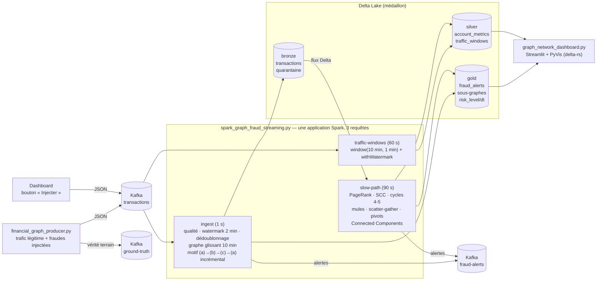

# Architecture technique

## Vue d'ensemble

## Deux vitesses : pourquoi ?

| | Chemin rapide (`ingest`) | Chemin lent (`slow-path`) |
|---|---|---|
| Question posée | « Cette transaction ferme-t-elle une boucle ? » | « Qui sont les comptes centraux, les mules, les réseaux ? » |
| Portée | Les arêtes touchées par le micro-batch | Tout le graphe de la fenêtre de 10 min |
| Algorithmes | Motif finding GraphFrames incrémental | PageRank, SCC, CC, motifs à 2/4/5 sauts |
| Cadence | Micro-batch toutes les secondes | Toutes les 90 s |
| Latence typique | Quelques secondes | ≤ 1 min 30 |

Un algorithme global (PageRank, composantes) ne peut pas tourner en moins d'une seconde
sur un graphe qui change en permanence. Séparer les deux échelles de temps permet
d'alerter vite sur la typologie la plus urgente (le carrousel), sans renoncer à
l'analyse structurelle.

## Décisions de conception

### 1. Recherche de motifs incrémentale
GraphFrames ne s'applique pas à un flux : le graphe est reconstruit dans `foreachBatch`.
Rechercher les triangles sur toute la fenêtre à chaque micro-batch serait quadratique.
On n'examine que les triangles **fermés par une arête nouvelle** :

> un triangle contenant l'arête nouvelle u→v est formé de v→w et w→u,
> où w est à la fois successeur de v et prédécesseur de u.

Les candidats sont élagués à partir des petits ensembles du lot (bénéficiaires et
émetteurs des arêtes nouvelles), puis le motif GraphFrames
`(a)-[e1]->(b); (b)-[e2]->(c); (c)-[e3]->(a)` tourne sur quelques dizaines d'arêtes
matérialisées (`localCheckpoint`, qui conserve les statistiques : jointures broadcast).
**Le coût suit la taille du lot, pas celle de la fenêtre.**

### 2. Cycles temporels
Un vrai circuit d'argent suit l'ordre chronologique : e1 < e2 < e3 et la boucle
tient en 10 minutes. Ce filtre :
- élimine les triangles « accidentels » (le commerce légitime crée aussi des boucles) ;
- garantit qu'un cycle n'est rapporté **qu'une fois** (une seule rotation possible).

### 3. Cycles longs : SCC + élagage
Tout cycle orienté est contenu dans une **composante fortement connexe**. Sur le graphe
des gros flux (≥ 20 000 MAD), on retire d'abord itérativement les comptes sans arête
entrante ou sortante (*trimming* : ils ne peuvent appartenir à aucun cycle), puis on
calcule les SCC, et on ne lance les motifs à 4 et 5 sauts qu'à l'intérieur des SCC de
taille suffisante. On évite l'explosion combinatoire d'un motif long sur tout le graphe.

### 4. PageRank seul ne suffit pas
Les commerçants très actifs ont un PageRank élevé sans être frauduleux. Le PageRank est
calculé sur le graphe des gros flux et **combiné** aux cycles : un compte est « pivot »
s'il participe à au moins 2 cycles récents ; son PageRank augmente son score.
Le dashboard montre explicitement la différence entre hubs légitimes et pivots suspects.

### 5. Connected Components sur le graphe suspect
Sur tout le graphe, une seule composante géante (le réseau bancaire est connexe) : peu
informatif. Les CC sont calculées sur le **sous-graphe des comptes déjà alertés** : elles
révèlent les réseaux qui relient plusieurs schémas (ex. 3 carrousels partageant un pivot).

### 5 bis. Mules : pic de vélocité
Une mule et un commerçant reçoivent tous deux beaucoup de petits paiements avant un gros
virement. Ce qui les distingue est le rythme : le chemin lent compare les dépôts des 6 minutes
précédant le retrait au rythme habituel du compte sur les 20 minutes d'avant (lues dans le
bronze). Il faut donc ~12 minutes d'historique au démarrage (démarrage à froid).

### 6. Watermark de 2 minutes
- Agrégation de trafic : `withWatermark("event_time", "2 minutes")` + `window(10 min, 1 min)`
  (API native, état purgé automatiquement).
- Chemin rapide : même politique, appliquée explicitement dans `foreachBatch`
  (événement plus vieux que *max(event_time) − 2 min* → écarté et compté).
- Le graphe glissant garde 10 + 2 minutes d'arêtes pour accepter les retardataires.

### 7. Exactly-once de bout en bout côté lakehouse

| Mécanisme | Effet |
|---|---|
| Checkpoints Structured Streaming | reprise aux offsets Kafka exacts |
| `txnAppId` / `txnVersion` sur chaque écriture Delta | un micro-batch rejoué n'est pas réécrit |
| `alert_id` = empreinte des transactions | une alerte rejouée garde le même identifiant |
| Reconstruction du graphe glissant depuis le bronze | aucun état perdu au redémarrage |

La sortie Kafka `fraud-alerts` est *at-least-once* (limite du protocole sans transactions
Kafka) ; l'`alert_id` déterministe rend les doublons inoffensifs pour les consommateurs.

### 8. Lakehouse médaillon
- **bronze** : transactions validées (contraintes `CHECK` : montant > 0, pas d'auto-virement)
  et quarantaine des messages invalides ;
- **silver** : métriques de graphe par compte, trafic fenêtré ;
- **gold** : alertes et sous-graphes, partitionnés `risk_level / dt=YYYY-MM-DD`,
  tables `appendOnly` (piste d'audit immuable), historique consultable (*time travel*).

Le dashboard lit Delta avec **delta-rs** (sans JVM) : démarrage instantané et élagage
des partitions `dt`.

### 9. Ordonnancement FAIR
Les trois requêtes partagent les cœurs. Des pools FAIR (`conf/fairscheduler.xml`) donnent
la priorité au chemin rapide ; le chemin lent travaille volontairement sur 1-2 partitions et
ne calcule PageRank, SCC et cycles longs qu'un passage sur deux, pour ne pas monopoliser les
cœurs. Les DataFrames matérialisés (`localCheckpoint`) sont libérés explicitement après usage :
dans un job de longue durée, ils provoqueraient sinon une fuite mémoire.

## Passage à l'échelle

| Aujourd'hui (démo portable) | En production |
|---|---|
| Spark `local[*]`, 1 conteneur | Cluster Spark (K8s / YARN), exécuteurs dédiés |
| 1 broker Kafka, 3 partitions | 3+ brokers, partitions par hash du compte émetteur |
| Graphe glissant en mémoire Spark | Idem, partitionné ; ou état `transformWithState` |
| Chemin lent dans la même application | Application séparée, planifiée, ressources isolées |
| Lakehouse sur volume Docker | Stockage objet (S3 / ADLS) + catalogue (Unity / Hive) |
