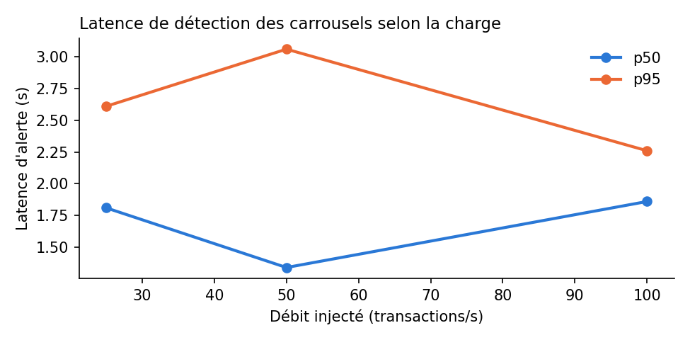
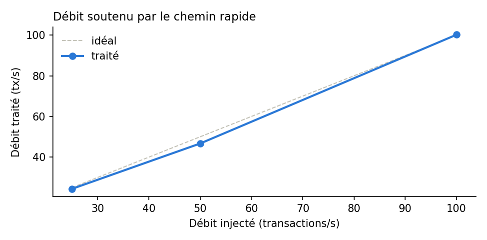

# Benchmark de montée en charge

_Portable, Docker Desktop (8 processeurs logiques partagés, ~6 Go), Spark `local[*]`, chemin lent actif. 150 s par palier ; un carrousel injecté toutes les 20 s._

| Débit injecté | Débit traité | Lignes par lot (méd.) | Durée d'un lot p50 | p95 | Carrousels détectés | Latence p50 | Latence p95 |
|---:|---:|---:|---:|---:|---:|---:|---:|
| 25 tx/s | 24,4 tx/s | 50 | 1,9 s | 6,5 s | 8 | 1,81 s | 2,61 s |
| 50 tx/s | 46,7 tx/s | 89 | 1,7 s | 5,3 s | 8 | 1,34 s | 3,06 s |
| 100 tx/s | 100,2 tx/s | 177 | 1,7 s | 4,5 s | 8 | 1,86 s | 2,26 s |

Le débit traité suit le débit injecté jusqu'à 100 tx/s, et la latence d'alerte reste autour de 2 s : le coût du motif dépend de la taille du lot, pas du volume de la fenêtre. Le palier à 50 tx/s inclut la montée en charge du producteur.

