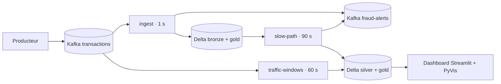
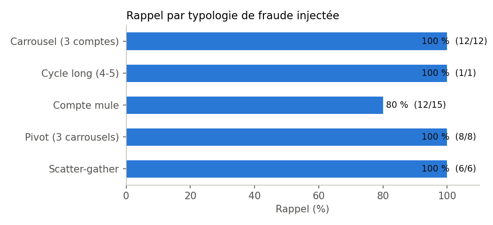
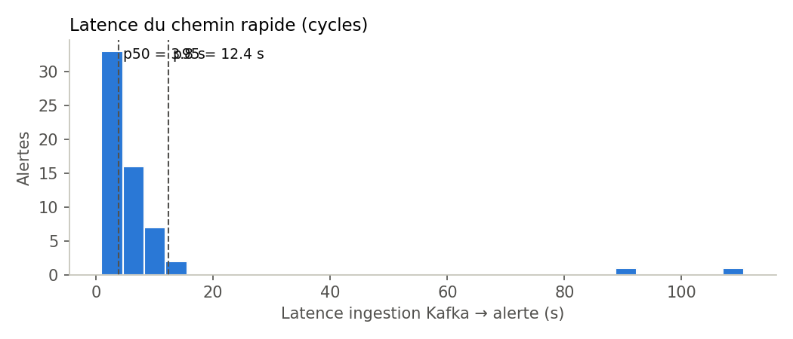
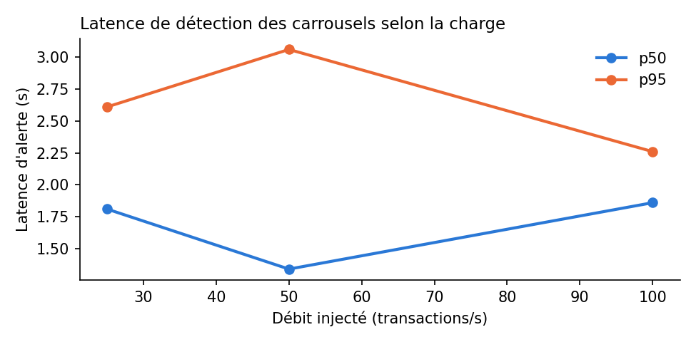

# Rapport technique — Graph Analytics & blanchiment d'argent

**Mini-projet 17 · Big Data** — Spark Structured Streaming · GraphFrames · PageRank · Motif Finding · Delta Lake

_[Prénom Nom] · [Prénom Nom] — encadré par [Nom de l'encadrant] — [date]_

---

## 1. Contexte et objectif

La **fraude en carrousel** consiste à faire circuler des fonds entre plusieurs sociétés,
souvent écrans, jusqu'à ce qu'ils reviennent à leur point de départ. Chaque étape prélève
une petite « commission » et prend l'apparence d'une opération commerciale. Pris
isolément, chaque virement est banal. Le schéma n'apparaît que lorsqu'on relie les
virements entre eux : c'est un **problème de graphe**.

Le sujet demande un pipeline Big Data qui construit dynamiquement un graphe orienté des
transactions, y exécute des algorithmes distribués (Motif Finding, PageRank, Connected
Components) et déclenche des alertes au plus tôt, en historisant les anomalies dans un
lakehouse Delta consultable visuellement.

## 2. Exigences et réalisation

| Exigence du sujet | Réalisation | Où |
|---|---|---|
| Motif `(a)-[e1]->(b); (b)-[e2]->(c); (c)-[e3]->(a)` | GraphFrames, recherche incrémentale, ordre temporel | `fraud/detection.py`, `ingest` |
| Fenêtre glissante 10 min, watermark 2 min | `window(10 min, 1 min)` + `withWatermark` ; graphe glissant 10 + 2 min | `traffic-windows`, `fraud/graph_index.py` |
| Identification des comptes mulets | Pic de vélocité de dépôts puis retrait unique | `find_mules` |
| PageRank : comptes pivots | Graphe des gros flux, combiné à la participation aux cycles | `slow-path` |
| Connected Components : isolement de clusters | Sur le sous-graphe des comptes alertés | `slow-path` |
| Émission directe dans Kafka `fraud-alerts` | JSON avec explication, `alert_id` déterministe | `publish` |
| Delta Lake partitionné `risk_level/dt` | Médaillon, `appendOnly`, contraintes `CHECK` | `fraud_graph_delta_schema.py` |
| Restitution Streamlit / PyVis | 5 onglets, injection en direct, fiche PDF, time travel | `graph_network_dashboard.py` |

Au-delà du sujet : composantes fortement connexes et cycles de 4 à 5 comptes,
scatter-gather, score expliqué, contrôle qualité et quarantaine, tolérance aux pannes
démontrée, évaluation contre une vérité terrain, tests automatisés et intégration continue.

## 3. Architecture



### 3.1 Deux vitesses

| | Chemin rapide (`ingest`) | Chemin lent (`slow-path`) |
|---|---|---|
| Question | La nouvelle transaction ferme-t-elle une boucle ? | Qui sont les pivots, mules et réseaux ? |
| Portée | Arêtes touchées par le micro-batch | Tout le graphe de la fenêtre de 10 min |
| Algorithmes | Motif GraphFrames incrémental | PageRank, SCC, CC, motifs à 2, 4 et 5 sauts |
| Cadence | Déclencheur 1 s | Toutes les 90 s |

Un algorithme global ne peut pas s'exécuter en une seconde sur un graphe qui change en
permanence. Séparer les deux échelles de temps permet d'alerter vite sur la typologie la
plus urgente sans renoncer à l'analyse structurelle.

### 3.2 Choix technologiques

| Composant | Version | Justification |
|---|---|---|
| Apache Kafka (KRaft) | 4.2 | Journal distribué, rejouable ; pas de ZooKeeper |
| Apache Spark | 3.5.7 | Structured Streaming mature ; Java 17 |
| GraphFrames | 0.12.3 | Motif finding, PageRank, SCC, CC sur DataFrames |
| Delta Lake | 3.3.2 | ACID, écritures idempotentes, contraintes, time travel |
| Streamlit, PyVis, delta-rs | 1.50, 0.3, 1.1 | Dashboard Python, graphes interactifs, lecture Delta sans JVM |
| Docker Compose | — | Démarrage en une commande, démo hors ligne (jars pré-chargés) |

Trois requêtes partagent une même application Spark, avec un ordonnancement FAIR qui donne
la priorité au chemin rapide.

## 4. Données

### 4.1 Message JSON (conforme au sujet)

```json
{"transaction_id": "TXN-2026-8821", "source_account": "ACC-8812", "target_account": "ACC-4490",
 "montant": 45000.00, "devise": "MAD", "type_operation": "VIREMENT_COMMERCIAL",
 "timestamp": "2026-10-07T10:15:00Z"}
```

### 4.2 Générateur (`financial_graph_producer.py`)

- 10 000 comptes ; activité d'émission en loi de puissance ; 2 % de **commerçants** très
  sollicités (hubs légitimes) ; bénéficiaires habituels par compte (85 % du trafic).
- Montants log-normaux par type d'opération (médianes de 1 500 à 12 000 MAD).
- **Bruit réaliste** : 0,2 % d'événements en retard (moitié acceptée, moitié au-delà du
  watermark) et 0,05 % de messages invalides (montant négatif, auto-virement, champ manquant).
- **Fraudes injectées**, inspirées de la typologie de l'IBM AML dataset (Altman et al.,
  NeurIPS 2023), sur des comptes « dormants » :

| Scénario | Description |
|---|---|
| Carrousel | 3 comptes, l'argent revient à l'origine, 1 à 3 % de perte par étape |
| Cycle long | 4 ou 5 comptes, même principe |
| Compte mule | 8 à 14 dépôts < 10 000 MAD, puis un retrait de 90 à 97 % |
| Scatter-gather | Une source éclate un montant vers 4 à 6 intermédiaires qui reversent à une destination |
| Pivot | Un compte au centre de 3 carrousels |

Chaque fraude est publiée avec sa **vérité terrain** dans le topic `ground-truth`, ce qui
permet de mesurer rappel, précision et délai de détection.

## 5. Algorithmes

### 5.1 Recherche incrémentale du triangle (chemin rapide)

GraphFrames s'applique à des DataFrames statiques : le graphe est donc analysé dans
`foreachBatch`. Chercher tous les triangles de la fenêtre (~30 000 arêtes) à chaque
seconde serait trop coûteux.

**Propriété utilisée.** Un triangle contenant une arête nouvelle `u→v` est formé de `v→w`
et `w→u`, où `w` est à la fois successeur de `v` et prédécesseur de `u`. Il suffit donc :

1. de garder le graphe glissant (10 min + 2 min de watermark) dans un **index d'adjacence**
   par compte (arêtes sortantes et entrantes) ;
2. pour chaque micro-batch, d'extraire en O(taille du lot) les arêtes `v→w` et `w→u` dont le
   sommet `w` est commun aux deux ensembles ;
3. de lancer le motif GraphFrames sur ce **sous-graphe candidat** (quelques dizaines d'arêtes),
   en exigeant qu'au moins une arête soit nouvelle.

**Ordre temporel.** On impose `e1 < e2 < e3` et une durée totale ≤ 10 min. C'est la
signature d'un flux d'argent réel ; cela élimine les boucles « accidentelles » du commerce
légitime et garantit qu'un cycle n'est rapporté qu'une fois (une seule rotation possible).
Un cycle n'est complet qu'à l'arrivée de sa dernière arête : il est donc détecté une seule
fois, au moment précis où il se ferme.

### 5.2 Cycles longs : élagage + composantes fortement connexes

Tout cycle orienté est contenu dans une **composante fortement connexe (SCC)**. Sur le
graphe des gros flux (≥ 20 000 MAD), on retire d'abord itérativement les comptes sans arête
entrante ou sans arête sortante : ils ne peuvent appartenir à aucun cycle. Sur une fenêtre
réelle, **2 856 arêtes deviennent 35**. Les SCC sont calculées sur ce noyau, puis les motifs à
4 et 5 sauts ne sont cherchés qu'à l'intérieur des SCC de taille suffisante.

### 5.3 PageRank et comptes pivots

Le PageRank est calculé sur le graphe agrégé des gros flux. Seul, il désigne aussi les
commerçants très actifs, qui sont légitimes : le dashboard le montre explicitement. Un compte
est donc **pivot** lorsqu'il participe à au moins deux cycles récents ; son percentile de
PageRank augmente son score.

### 5.4 Connected Components et réseaux

Sur tout le graphe, les composantes connexes forment une composante géante, peu informative.
Elles sont calculées sur le **sous-graphe des comptes déjà alertés** : un réseau qui relie au
moins deux alertes devient une alerte `CLUSTER` (par exemple, trois carrousels partageant un
pivot donnent un réseau de 7 comptes).

### 5.5 Mules et scatter-gather

**Comptes mules.** On repère le plus gros virement sortant d'un compte (le « retrait ») et l'on
examine les dépôts des 6 minutes qui le précèdent :

- au moins 6 émetteurs distincts et 30 000 MAD déposés ;
- un **pic de vélocité** : au moins 3 fois plus de dépôts que le rythme habituel du compte,
  mesuré sur les 20 minutes précédentes (lues dans le bronze) ;
- un retrait unique qui reprend 75 à 102 % de la rafale.

La règle a été construite par itérations mesurées contre la vérité terrain :

| Version de la règle | Mules retrouvées | Faux positifs |
|---|---:|---:|
| Fan-in + sortie ≥ 80 % de l'entrée | 5 / 6 | 18 |
| + retrait unique, après le dernier dépôt | 4 / 9 | 0 |
| + seuls les dépôts antérieurs au retrait comptent | 10 / 11 | 22 |
| **+ pic de vélocité par rapport au rythme habituel** | **7 / 11** (7 / 8 hors démarrage) | **0** |
| **Run final** (comptes écrans réellement calmes) | **12 / 15** | **0** |

Les faux positifs venaient de comptes actifs légitimes (commerçants) qui reçoivent en continu et
font parfois un gros paiement ; les manques, de paiements légitimes reçus *après* le retrait. Le
pic de vélocité, indicateur classique en LCB-FT, sépare les deux. Il demande un historique :
pendant les 12 premières minutes du pipeline (**démarrage à froid**), aucun compte n'est jugé sur
ce critère.

**Scatter-gather.** Motif GraphFrames à deux sauts `(s)-[e1]->(m); (m)-[e2]->(t)` avec au moins
3 intermédiaires distincts qui reversent 90 à 100 % du montant.

### 5.6 Score et explicabilité

Chaque alerte reçoit un score de 0 à 100, somme de règles lisibles, et une explication en
français. Exemple réel :

> ACC-9465 → ACC-1886 → ACC-9924 → ACC-9465 en 1 min 22 s, 3 virements de 58 778 MAD à
> 61 400 MAD, 95,7 % du montant revient à l'origine. Indices : montants quasi identiques à
> chaque étape (écart max 4,5 %) (+30) ; perte régulière de 2,2 % par étape (+15) ; boucle
> bouclée en 1 min 22 s (+20) ; montants significatifs (+10) ; même type d'opération (+5) ;
> un compte du cycle est un pivot du réseau (+5).

| Niveau | Score | Destination |
|---|---|---|
| Faible | 20 – 39 | Delta uniquement (audit) |
| Moyen | 40 – 69 | Delta + Kafka |
| Élevé | 70 – 89 | Delta + Kafka |
| Critique | 90 – 100 | Delta + Kafka |

## 6. Lakehouse Delta (`fraud_graph_delta_schema.py`)

| Couche | Table | Partitions | Garanties |
|---|---|---|---|
| Bronze | `transactions` | `dt` | `CHECK (montant > 0)`, `CHECK (source_account <> target_account)` |
| Bronze | `transactions_quarantine` | `dt` | Motif du rejet conservé |
| Silver | `account_metrics` | `dt` | Instantanés PageRank, SCC, cluster, taux de passage |
| Silver | `traffic_windows` | `dt` | Agrégat de la fenêtre glissante (MERGE) |
| Gold | `fraud_alerts` | `risk_level`, `dt` | `appendOnly`, `CHECK` sur score et niveau |
| Gold | `anomaly_subgraph_vertices` / `_edges` | `risk_level`, `dt` | `appendOnly` |

Le DDL complet s'obtient avec `python fraud_graph_delta_schema.py --print-ddl`. Les tables
gold sont une **piste d'audit immuable** ; leur historique reste consultable (*time travel*).

## 7. Fiabilité

| Mécanisme | Effet |
|---|---|
| Checkpoints Structured Streaming | Reprise aux offsets Kafka exacts |
| `txnAppId` / `txnVersion` sur chaque écriture Delta | Un micro-batch rejoué n'est pas réécrit |
| `alert_id` = empreinte du type et des transactions | Une alerte rejouée garde son identifiant |
| Ordre d'écriture : alerte → gold → bronze | Un lot interrompu est redétecté au rejeu, sans doublon |
| Graphe glissant reconstruit depuis le bronze | Aucun état perdu au redémarrage |

**Test de panne** (`scripts/demo.ps1 crash`) : `docker compose kill` du job Spark en pleine
ingestion (50 transactions/s), redémarrage, puis contrôle d'intégrité :

```
graphe glissant reconstruit : 25 147 arêtes
[OK ] Transactions en double dans le bronze : 0
[OK ] Transactions violant les contraintes métier : 0
[OK ] Alertes en double dans le gold : 0
[OK ] Sous-graphes sans alerte (orphelins) : 0
```

La sortie Kafka `fraud-alerts` reste *at-least-once* ; l'identifiant déterministe rend un
doublon éventuel inoffensif pour les consommateurs.

## 8. Dashboard (`graph_network_dashboard.py`)

| Onglet | Contenu |
|---|---|
| Vue d'ensemble | Indicateurs, réseau suspect en direct (PyVis), dernières alertes, alertes par minute, trafic fenêtré |
| Alertes & investigation | Filtres, sous-graphe de l'alerte, explication, transactions, **fiche PDF** |
| Explorateur de réseau | Voisinage d'un compte à 1 ou 2 sauts, PageRank : hubs légitimes et comptes alertés |
| Santé du pipeline | Durée des étapes par micro-batch, latence, débit, watermark, quarantaine |
| Audit Delta Lake | Partitions, historique des versions, time travel |

La barre latérale permet d'**injecter une fraude** et affiche, pour chacune, si elle a été
détectée et en combien de secondes.

## 9. Démarche de performance

Les premières versions ne tenaient pas la charge sur un portable (8 processeurs logiques
partagés, environ 6 Go pour Docker). Chaque étape a été mesurée, à partir des métriques
écrites par le job (`fast_path.jsonl`) et de la Spark UI.

| Version | Débit | Durée d'un micro-batch | Détection du motif | Latence d'alerte |
|---|---|---|---|---|
| Motif sur toute la fenêtre, 5 requêtes | 100 tx/s | 80 – 180 s | 65 – 175 s | > 1 min |
| + sous-graphe candidat matérialisé | 100 tx/s | 13 – 40 s | 5 – 25 s | 20 – 60 s |
| + 3 requêtes, partitions maîtrisées, chemin lent bridé | 50 tx/s | 14 s (médiane) | 6,5 s | 5 – 22 s |
| + index d'adjacence et transferts Arrow | 50 tx/s | 4,1 s | 0,8 s | 2,5 – 5 s |
| **+ libération mémoire, analyses lourdes un passage sur deux (finale, run de 42 min)** | 50 tx/s | **3,4 s** | **0,7 s** | **3,8 s (p50) · 10,7 s (p95)** |

Leçons retenues :

- **Matérialiser** ce qu'un motif GraphFrames relit : sans cela, la lignée est recalculée pour
  chaque alias d'arête et de sommet (jusqu'à 86 jobs pour un seul micro-batch).
- **Construire les petits DataFrames via Arrow** puis `localCheckpoint` : 0,1 s au lieu de 1 s,
  et des statistiques conservées qui permettent les jointures *broadcast*.
- **Ne pas passer des milliers de littéraux à `isin()`** (un aller-retour py4j par valeur).
- **Matérialiser chaque itération** d'un algorithme itératif, sinon le plan double à chaque tour.
- **Borner le chemin lent** : 1 à 2 partitions, et PageRank/SCC/cycles longs un passage sur
  deux, pour que les analyses globales n'affament pas le chemin rapide.
- **Libérer explicitement les points de contrôle locaux** : `unpersist()` ne les libère pas.
  Après 30 minutes de fonctionnement, 317 RDD matérialisés occupaient la mémoire et les
  écritures Delta ralentissaient jusqu'à 170 s ; une libération explicite et un GC Spark toutes
  les 2 minutes stabilisent la mémoire.

## 10. Résultats

_Mesures produites par `scripts/evaluate.py` et `scripts/benchmark.py` ; les fichiers
[resultats.md](resultats.md) et [benchmark.md](benchmark.md) contiennent le détail._

**Protocole.** Run de 42 minutes avec le code final : 12 minutes de chauffe (trafic légitime
seul), puis 30 minutes à 50 transactions/s avec une fraude injectée toutes les 30 s, réparties
sur les 5 typologies. Le rappel porte sur les fraudes injectées au moins 8 minutes avant la
mesure (temps de laisser le chemin lent passer) ; la précision compare chaque alerte de niveau
moyen ou plus à toute la vérité terrain.

| Indicateur | Valeur |
|---|---|
| **Rappel** | **92,9 %** (39 fraudes sur 42) |
| **Précision** | **99,0 %** (101 alertes vraies sur 102) |
| Délai de détection d'un carrousel | **3,9 s** en médiane, 8,1 s au maximum |
| Latence des alertes du chemin rapide | 3,8 s (p50), 10,7 s (p95) |
| Débit traité | 51 transactions/s (charge injectée : 50) |
| Mémoire du conteneur Spark | stable, palier vers 3,0 Go sur 4 |

| Typologie | Injectées | Détectées | Rappel | Délai médian |
|---|---:|---:|---:|---:|
| Carrousel (3 comptes) | 12 | 12 | 100 % | 3,9 s |
| Pivot (3 carrousels) | 8 | 8 | 100 % | 4,9 s |
| Scatter-gather | 6 | 6 | 100 % | 70 s |
| Cycle long (4-5 comptes) | 1 | 1 | 100 % | 79 s |
| Compte mule | 15 | 12 | 80 % | 59 s |

| Type d'alerte | Alertes | Vraies | Précision |
|---|---:|---:|---:|
| CYCLE | 49 | 48 | 98,0 % |
| PIVOT | 11 | 11 | 100 % |
| CLUSTER | 20 | 20 | 100 % |
| MULE | 13 | 13 | 100 % |
| SCATTER_GATHER | 8 | 8 | 100 % |
| CYCLE_LONG | 1 | 1 | 100 % |





Les typologies du chemin lent sont détectées en une à deux minutes : elles ne sont analysées
que toutes les 90 s, et seulement une fois le schéma terminé. Les comptes mules restent la
typologie la plus difficile (80 %) : leur détection repose sur un rythme habituel appris et sur
un seuil de retrait.

**Étude d'ablation (carrousels).** La détection est rejouée hors ligne sur 90 323 transactions
d'un run précédent, en ajoutant les filtres un à un :

| Étape | Cycles retenus | Vrais carrousels | Précision | Carrousels retrouvés |
|---|---:|---:|---:|---:|
| Motif seul `(a)->(b)->(c)->(a)` | 233 | 68 | 29,2 % | 36 / 36 |
| + ordre temporel et durée ≤ 10 min | 91 | 68 | 74,7 % | 36 / 36 |
| + score ≥ MEDIUM | 69 | 68 | 98,6 % | 36 / 36 |

Chaque filtre retire des faux positifs sans perdre un seul vrai carrousel.

**Montée en charge.** Un carrousel toutes les 20 s, 150 s par palier, chemin lent actif :

| Débit injecté | Débit traité | Durée d'un lot (p50) | Latence carrousel p50 · p95 |
|---:|---:|---:|---:|
| 25 tx/s | 24,4 tx/s | 1,9 s | 1,8 s · 2,6 s |
| 50 tx/s | 46,7 tx/s | 1,7 s | 1,3 s · 3,1 s |
| 100 tx/s | 100,2 tx/s | 1,7 s | 1,9 s · 2,3 s |

Le débit suit la charge jusqu'à 100 tx/s et la latence reste vers 2 s : le coût du motif suit la taille du lot. Sous la charge de fraude plus dense du run d'évaluation (une fraude toutes les 30 s, chemin lent très sollicité), elle passe à 3,8 s en médiane.



## 11. Limites et perspectives

- **Latence** : quelques secondes sur un portable, pas sous la seconde. Le motif s'exécute en
  moins d'une seconde ; le reste est le coût fixe des micro-batches et des écritures Delta. Sur
  un cluster, le chemin rapide disposerait d'exécuteurs dédiés.
- **Portée** : les cycles de plus de 5 comptes ne sont pas recherchés ; une fraude étalée sur
  plus de 10 minutes échappe au chemin rapide.
- **Score** : des règles lisibles, réglées à la main. Les fiches d'investigation remplies par
  les analystes fourniraient les étiquettes d'un modèle supervisé (gradient boosting sur les
  métriques de graphe, ou réseau de neurones sur graphes).
- **Données** : synthétiques. Une validation sur l'IBM AML dataset rejoué dans Kafka serait
  l'étape suivante.

## 12. Conclusion

La plateforme répond à chaque exigence du sujet et les dépasse sur trois points mesurés :
la détection incrémentale des carrousels en quelques secondes, l'analyse structurelle
(PageRank, SCC, Connected Components) qui relie les schémas en réseaux, et un lakehouse
auditable qui ne perd ni ne duplique rien après une panne. Chaque alerte est expliquée, et
chaque chiffre de ce rapport se reproduit avec une commande du dépôt.

## Annexe — reproduire

```powershell
.\scripts\demo.ps1 start       # plateforme complète
.\scripts\demo.ps1 tests       # 27 tests (pur Python + Spark)
.\scripts\demo.ps1 crash       # test de panne + intégrité
.\scripts\demo.ps1 evaluate    # rappel, précision, latence
.\scripts\demo.ps1 benchmark   # montée en charge
.\scripts\demo.ps1 ablation    # apport de chaque filtre
```
