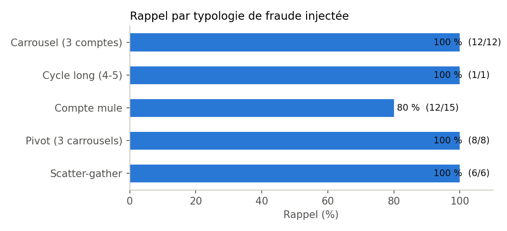
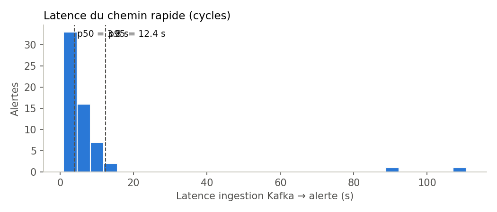

# Résultats de l'évaluation

_Généré le 2026-11-18 21:08:52 UTC — période de 29.5 min, 42 fraudes injectées, 111 alertes (dont 102 de niveau ≥ MEDIUM)._

## Rappel par typologie

| Typologie | Injectées | Détectées | Rappel | Délai médian | Délai max |
|---|---:|---:|---:|---:|---:|
| Carrousel (3 comptes) | 12 | 12 | 100 % | 3.87 s | 8.053 s |
| Cycle long (4-5) | 1 | 1 | 100 % | 79.179 s | 79.179 s |
| Compte mule | 15 | 12 | 80 % | 59.392 s | 505.756 s |
| Pivot (3 carrousels) | 8 | 8 | 100 % | 4.934 s | 80.097 s |
| Scatter-gather | 6 | 6 | 100 % | 69.773 s | 88.423 s |

**Rappel global : 92.9 %**

## Précision des alertes (niveau ≥ MEDIUM)

| Type d'alerte | Alertes | Vraies | Précision |
|---|---:|---:|---:|
| CLUSTER | 20 | 20 | 100.0 % |
| CYCLE | 49 | 48 | 98.0 % |
| CYCLE_LONG | 1 | 1 | 100.0 % |
| MULE | 13 | 13 | 100.0 % |
| PIVOT | 11 | 11 | 100.0 % |
| SCATTER_GATHER | 8 | 8 | 100.0 % |

**Précision globale : 99.0 %**

## Latence et débit

- Latence chemin rapide (ingestion Kafka → alerte) : p50 **3.8 s**, p95 **10.71 s**, p99 12.43 s
- Débit de traitement médian du chemin rapide : 51 tx/s
- Répartition des alertes par niveau : {'HIGH': 69, 'CRITICAL': 19, 'MEDIUM': 14, 'LOW': 9}

## Graphiques

